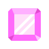
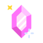
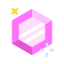
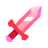

# DiscordBadges

Discordのプロフィールバッジの一覧です。

| 名前 | 画像 | 入手可能性 | 入手方法 |
|------|-----|-----------|----------|
| Discord Staff |  | ✅ | Discordのスタッフになる |
| Nitro Starter |  | ✅ | Discord Nitro Basic または Discord Nitro Standard に加入する |
| Nitro Bronze |  | ✅ | Discord Nitro Standard に1か月間加入する |
| Nitro Gold |  | ✅ | Discord Nitro Standard に3か月間加入する |
| Nitro Silver |  | ✅ | Discord Nitro Standard に6か月間加入する |
| Nitro Platinum |  | ✅ | Discord Nitro Standard に1年間加入する |
| Nitro Diamond |  | ✅ | Discord Nitro Standard に2年間加入する |
| Nitro Emerald |  | ✅ | Discord Nitro Standard に3年間加入する |
| Nitro Ruby |  | ✅ | Discord Nitro Standard に5年間加入する |
| Nitro Opal |  | ✅ | Discord Nitro Standard に6年間以上加入する |
| Nitro (Old) |  | ❌ | Discord Nitro Basic または Discord Nitro Standard に加入する |
| Nitro Bronze (Old) |  | ❌ | Discord Nitro Standard に1か月間加入する |
| Nitro Gold (Old) |  | ❌ | Discord Nitro Standard に3か月間加入する |
| Nitro Silver (Old) |  | ❌ | Discord Nitro Standard に6か月間加入する |
| Nitro Platinum (Old) |  | ❌ | Discord Nitro Standard に1年間加入する |
| Nitro Diamond (Old) |  | ❌ | Discord Nitro Standard に2年間加入する |
| Nitro Emerald (Old) |  | ❌ | Discord Nitro Standard に3年間加入する |
| Nitro Ruby (Old) |  | ❌ | Discord Nitro Standard に5年間加入する |
| Nitro Fire (Old) |  | ❌ | Discord Nitro Standard に6年間以上加入する |
| Server Boosting 1 Month |  | ✅ | サーバーブーストを購入する |
| Server Boosting 2 Month |  | ✅ | サーバーブーストを2か月間購入する |
| Server Boosting 3 Month |  | ✅ | サーバーブーストを3か月間購入する |
| Server Boosting 6 Month |  | ✅ | サーバーブーストを6か月間購入する |
| Server Boosting 9 Month |  | ✅ | サーバーブーストを9か月間購入する |
| Server Boosting 12 Month |  | ✅ | サーバーブーストを12か月間購入する |
| Server Boosting 15 Month |  | ✅ | サーバーブーストを15か月間購入する |
| Server Boosting 18 Month |  | ✅ | サーバーブーストを18か月間購入する |
| Server Boosting 24 Month |  | ✅ | サーバーブーストを24か月間購入する |
| Game Variety Sampler |  | ✅ | 2種類の検出可能なゲームをプレイする |
| Game Variety Dabbler |  | ✅ | 5種類の検出可能なゲームをプレイする |
| Game Variety Enthusiast |  | ✅ | 10種類の検出可能なゲームをプレイする |
| Game Variety Ranger |  | ✅ | 15種類の検出可能なゲームをプレイする |
| Game Variety Explorer |  | ✅ | 20種類の検出可能なゲームをプレイする |
| Game Variety Adventurer |  | ✅ | 30種類の検出可能なゲームをプレイする |
| Game Variety Voyager |  | ✅ | 40種類の検出可能なゲームをプレイする |
| Game Variety Maverick |  | ✅ | 60種類の検出可能なゲームをプレイする |
| Game Variety Polymath |  | ✅ | 80種類の検出可能なゲームをプレイする |
| Game Variety Universalist |  | ✅ | 100種類以上の検出可能なゲームをプレイする |
| Game Time Casual |  | ✅ | 1時間検出可能なゲームをプレイする |
| Game Time Recreational |  | ✅ | 5時間検出可能なゲームをプレイする |
| Game Time Dedicated |  | ✅ | 20時間検出可能なゲームをプレイする |
| Game Time Committed |  | ✅ | 75時間検出可能なゲームをプレイする |
| Game Time Serious |  | ✅ | 150時間検出可能なゲームをプレイする |
| Game Time Devoted |  | ✅ | 300時間検出可能なゲームをプレイする |
| Game Time Seasoned |  | ✅ | 500時間検出可能なゲームをプレイする |
| Game Time Ironclad |  | ✅ | 1,000時間検出可能なゲームをプレイする |
| Game Time Unshakeable |  | ✅ | 2,000時間検出可能なゲームをプレイする |
| Game Time Eternal |  | ✅ | 5,000時間以上検出可能なゲームをプレイする |
| Streaming Newcomer |  | ✅ | 1時間自分の配信を見られる |
| Streaming Fledgling |  | ✅ | 5時間自分の配信を見られる |
| Streaming Breakout |  | ✅ | 20時間自分の配信を見られる |
| Streaming Standout |  | ✅ | 75時間自分の配信を見られる |
| Streaming Trendsetter |  | ✅ | 150時間自分の配信を見られる |
| Streaming Headliner |  | ✅ | 300時間自分の配信を見られる |
| Streaming Star |  | ✅ | 500時間自分の配信を見られる |
| Streaming Sensation |  | ✅ | 1,000時間自分の配信を見られる |
| Streaming Visionary |  | ✅ | 2,000時間自分の配信を見られる |
| Streaming Phenomenon |  | ✅ | 5,000時間以上自分の配信を見られる |
| Gifting Patron |  | ✅ | 1個のギフトを購入する |
| Gifting Champion |  | ✅ | 2個のギフトを購入する |
| Gifting Luminary |  | ✅ | 3個のギフトを購入する |
| Gifting Icon |  | ✅ | 6個のギフトを購入する |
| Gifting Hero |  | ✅ | 10個のギフトを購入する |
| Gifting Legend |  | ✅ | 20個以上のギフトを購入する |
| Account Age Seed |  | ✅ | 1年間Discordを利用する |
| Account Age Sprout |  | ✅ | 2年間Discordを利用する |
| Account Age Sapling |  | ✅ | 3年間Discordを利用する |
| Account Age Bud |  | ✅ | 4年間Discordを利用する |
| Account Age Blossom |  | ✅ | 5年間Discordを利用する |
| Account Age Redwood |  | ✅ | 6年間Discordを利用する |
| Account Age Sequoia |  | ✅ | 7年間Discordを利用する |
| Account Age Bristlecone |  | ✅ | 8年間Discordを利用する |
| Account Age Stromatolite |  | ✅ | 9年間Discordを利用する |
| Account Age Primordial |  | ✅ | 10年間以上Discordを利用する |
| Partnered Server Owner |  | ✅ | Discordのパートナーサーバーのオーナーになる |
| Discord Partner (Old) |  | ❌ | Discordのパートナーサーバーのオーナーになる |
| Moderator Programs Alumni |  | ❌ | Discordモデレータープログラムのサーバーに参加していたユーザーである |
| Discord Certified Moderator (Old) |  | ❌ | 優秀なDiscordモデレーターのユーザーである |
| HypeSquad Events |  | ❌ | HypeSquadのイベントに参加する |
| HypeSquad Brilliance |  | ✅ | HypeSquadのクイズに回答する / APIにリクエストを送る |
| HypeSquad Bravery |  | ✅ | HypeSquadのクイズに回答する / APIにリクエストを送る |
| HypeSquad Balance |  | ✅ | HypeSquadのクイズに回答する / APIにリクエストを送る |
| Golden HypeSquad Balance |  | ❌ | HypeSquad Balanceに入っている |
| Bug Hunter |  | ✅ | Discord Testersサーバーでバグを報告する |
| Golden Bug Hunter |  | ✅ | Discord Testersサーバーで多くのバグを報告する |
| Active Developer |  | ❌ | 30日間コマンドを使用されたアプリを所有して申請する |
| Early Verified Bot Developer |  | ❌ | 2020/08/19までに認証済みアプリを保有するチームのオーナーである |
| Early Supporter |  | ❌ | 2018/10/10 19:20 PDTまでにNitroサブスクリプションを購入する |
| Legacy Username |  | ❌ | 新しいユーザー名システムの前にアカウントを作成する |
| Clown |  | ❌ | 2025年のLootboxエイプリルフール体験ですべてのコレクションを集めて得られるアバターデコレーションをつける |
| Quests |  | ✅ | クエストをクリアする |
| Last Meadow Online |  | ❌ | 2026年のLast Meadow Onlineエイプリルフール体験をプレイする |
| Orbs Apprentice |  | ✅ | Discord Orbsを使ってバッジを購入する |
| The Void Eclipse |  | ✅ | Discord Orbsを1個消費する |
| The Void Stardust |  | ✅ | Discord Orbsを500個消費する |
| The Void Meteorite |  | ✅ | Discord Orbsを1,000個消費する |
| The Void Comet |  | ✅ | Discord Orbsを5,000個消費する |
| The Void Pulsar |  | ✅ | Discord Orbsを10,000個消費する |
| The Void Quasar |  | ✅ | Discord Orbsを30,000個消費する |
| The Void Aurora |  | ✅ | Discord Orbsを100,000個消費する |
| The Void Nebula |  | ✅ | Discord Orbsを200,000個消費する |
| The Void Nova |  | ✅ | Discord Orbsを350,000個消費する |
| The Void Supernova |  | ✅ | Discord Orbsを500,000個消費する |
| Supports Commands |  | ✅ | 有効なコマンドを1つ以上登録する |
| Uses AutoMod |  | ✅ | 有効なAutoModルールを100個作成する |
| Premium APP |  | ✅ | アプリのプレミアムを購入する |
